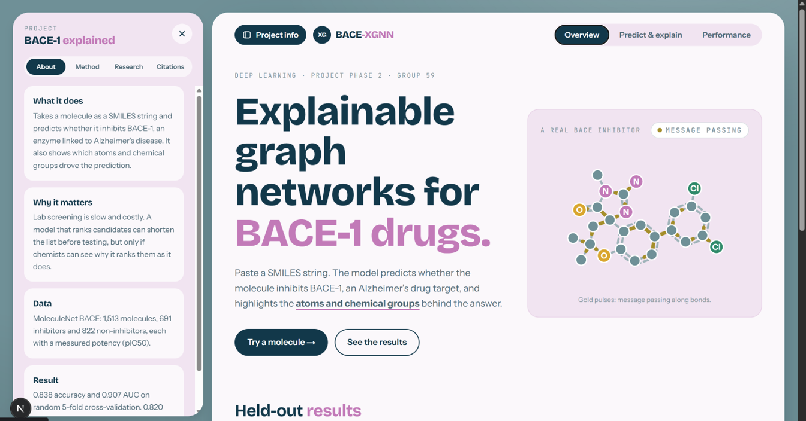
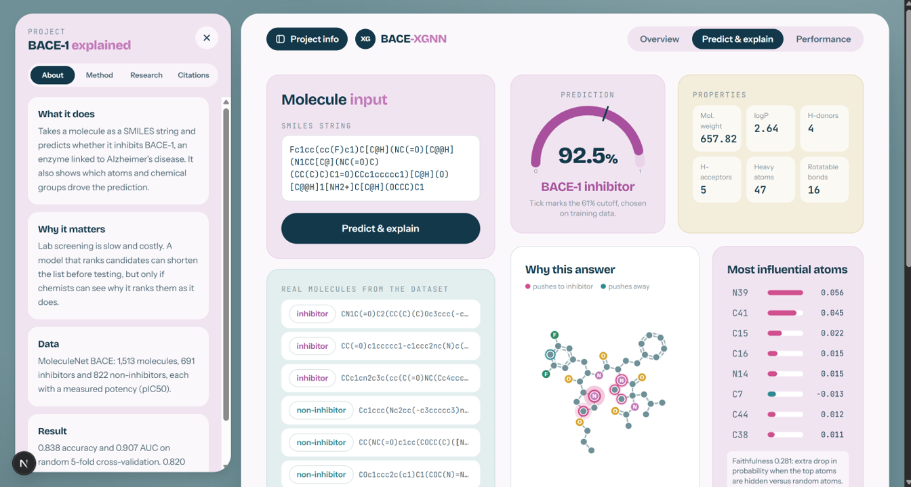
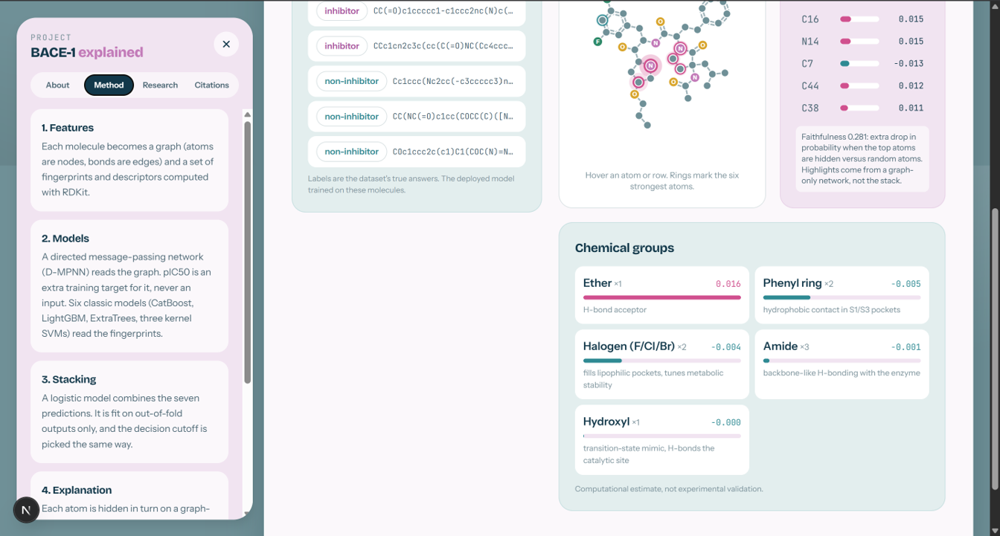
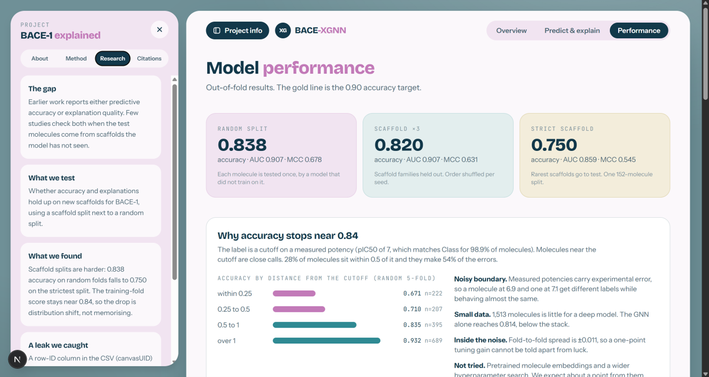
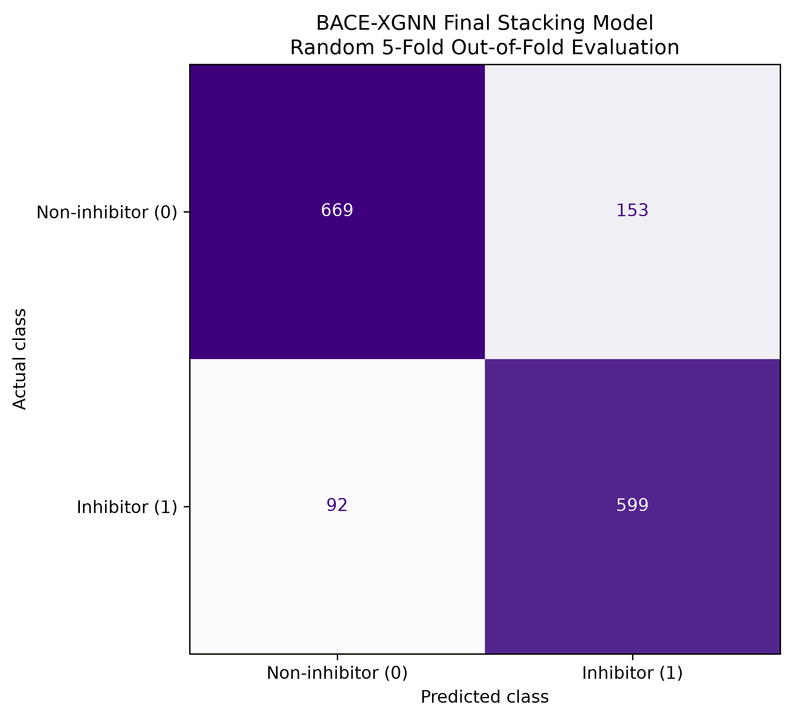
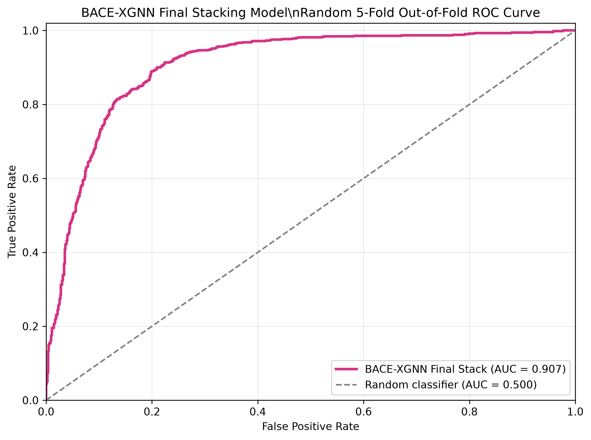

# BACE-XGNN

Explainable graph neural networks for BACE-1 inhibitor prediction (Deep Learning project, Group 59).

Paste a molecule as a SMILES string. The system predicts whether it inhibits the Alzheimer's-linked enzyme BACE-1, and shows which atoms and chemical groups drove the answer.

## Results

All numbers are out-of-fold: every test molecule is scored by a model that never saw it. The stacker, the decision threshold and early stopping use training data only.

| Setup | Accuracy | ROC-AUC | F1 | MCC | Sensitivity | Specificity |
|---|---|---|---|---|---|---|
| Random 5-fold CV | 0.838 | 0.907 | 0.830 | 0.678 | 0.867 | 0.814 |
| Scaffold split, 3 seeds | 0.820 | 0.907 | 0.785 | 0.631 | 0.777 | 0.852 |
| Strict scaffold split | 0.750 | 0.859 | 0.759 | 0.545 | 0.652 | 0.900 |

Phase 1 report, for comparison: 0.763 accuracy, 0.846 AUC (single GNN).

**Where this falls short of the 0.90 accuracy target.** We reach about 0.84 accuracy and 0.907 AUC. We did not tune on the test folds, drop hard molecules or pick lucky seeds to close the gap. Published BACE results sit around 0.85 to 0.90 AUC, so the AUC is in range.

**Overfitting check.** Accuracy on the inner training folds versus the untouched test fold: random 0.839 vs 0.838 (no gap), scaffold x3 0.841 vs 0.820. On the strict scaffold split it is 0.840 vs 0.750. That gap is distribution shift (rare, unfamiliar scaffolds), not memorising. The Performance page shows all of this.

### Explanation quality

Measured on 30 random molecules with the graph-only explainer network (3 seeds).

- Faithfulness: 0.475. Hiding the top 5 atoms lowers the predicted-class probability by 0.475 more than hiding 5 random atoms. It is positive for all 30 molecules. (An earlier explainer on the descriptor-fused network scored 0.004, because hiding an atom barely changed it.)
- Stability: 0.48. Mean pairwise Jaccard of the top 5 atoms across independently trained seeds. Seeds agree on about half of the top atoms, so treat single-atom highlights as indicative.

Highlights come from a graph-only network trained alongside the predictor, so they describe how a graph model reads the molecule. They are not proof of a binding mechanism.

## Data leak to know about

`canvasUID` in the MoleculeNet `bace.csv` is a row ID, and the file is sorted by class (inhibitors 1 to 825, non-inhibitors 103 to 1547). It alone gives 0.9998 AUC. Our first stack run showed 0.99 accuracy because of it. It is excluded, along with `pIC50` (Class matches pIC50 >= 7 for 98.9% of molecules), `Model` and `CID`. See `LEAK_COLS` in `backend/bace/data.py`.

Anyone who feeds the whole CSV to a model will get a fake 99%.

The CSV in this repo also has 595 columns, not the 593 stated in the Phase 1 report.

## How it works

1. **Data.** 1,513 molecules (691 inhibitors, 822 non-inhibitors). SMILES are canonicalised and de-duplicated.
2. **Features.** ECFP4/ECFP6/FCFP4 counts, atom-pair, topological torsion, MACCS, Avalon, RDKit descriptors. Every block is computable from a SMILES alone, so the deployed model needs no dataset columns.
3. **Models.** A D-MPNN (bond-passing graph network, Chemprop style) with descriptor fusion and an auxiliary pIC50 head (training target only, never an input). Six classic models: CatBoost, LightGBM, ExtraTrees and three Tanimoto-kernel SVMs.
4. **Stacking.** A logistic meta-learner on out-of-fold predictions. The decision threshold (0.61) is picked on out-of-fold predictions.
5. **Explanation.** Leave-one-atom-out occlusion on a graph-only network, then SMARTS patterns map atom scores to named groups (amidine, amide, halogen and so on).
6. **App.** FastAPI backend, Next.js frontend.

Viva preparation notes: [VIVA_PREP.md](VIVA_PREP.md)

## Run it

Needs Python 3.12 and Node 22. CPU is enough; no GPU is required.

```bash
cd backend
pip install -r requirements.txt

# serving needs these three artifacts (already in artifacts/ if you got the whole folder)
python -m bace.train_final --seeds 3                  # artifacts/gnn.pt
python -m bace.train_final --seeds 3 --graph-only     # artifacts/gnn_graph.pt (explainer)
python -m bace.train_stack                            # artifacts/stack.joblib

python -m uvicorn api:app --port 8000
```

```bash
cd frontend
npm install
npm run dev        # http://localhost:3000
```

API docs: http://localhost:8000/docs

### Reproduce the numbers

```bash
cd backend
python -m bace.ensemble                                # base models, 9 outer splits, parallel (~15 min)
python -m bace.cloud_run --out ../data/gnn_oof.npz --seeds 1 --inner 3 --epochs 40 --workers 6   # GNN out-of-fold (~20 min, CPU)
python -m bace.evaluate                                # merges both, writes artifacts/metrics.json
python -m bace.evaluate_explain                        # writes artifacts/explain_metrics.json
```

`kaggle/bace_gnn_cloud.ipynb` runs the GNN step on a Kaggle GPU instead. It is optional.

## Layout

```
backend/bace/data.py          loading, leak guard, random / scaffold / strict-scaffold splits
backend/bace/features.py      fingerprint and descriptor blocks
backend/bace/gnn.py           D-MPNN, descriptor fusion, pIC50 auxiliary head
backend/bace/ensemble.py      six base models + stacking, nested out-of-fold protocol
backend/bace/cloud_run.py     GNN out-of-fold predictions (CPU parallel or GPU)
backend/bace/evaluate.py      merge + metrics.json
backend/bace/explain.py       occlusion, SMARTS groups, faithfulness, stability
backend/bace/train_final.py   train the deployed GNN / explainer on all data
backend/bace/train_stack.py   fit the deployed stack on all data
backend/api.py                FastAPI service
frontend/                     Next.js app (overview, predict and explain, performance)
artifacts/                    trained models and metrics.json
```

## Caveats

- The deployed models are trained on all 1,513 molecules, so their predictions on dataset molecules are not a test. Only the cross-validated numbers above are.
- Scaffold splits are harder than random splits by design. We report both.
- The strict scaffold result is a single 152-molecule split, so it is noisy.
- A predicted BACE-1 activity is a computational estimate. It does not show experimental activity, safety or clinical value.
- Data: MoleculeNet BACE (Subramanian et al., J Chem Inf Model 2016; packaged by Wu et al., MoleculeNet, Chem Sci 2018). RDKit and PyTorch Geometric are used as tools.


## 📸 Project Screenshots

### Frontend Dashboard



### Molecular Prediction Interface



### Additional Frontend View




### Model Performance Dashboard




### Confusion Matrix



### ROC Curve


